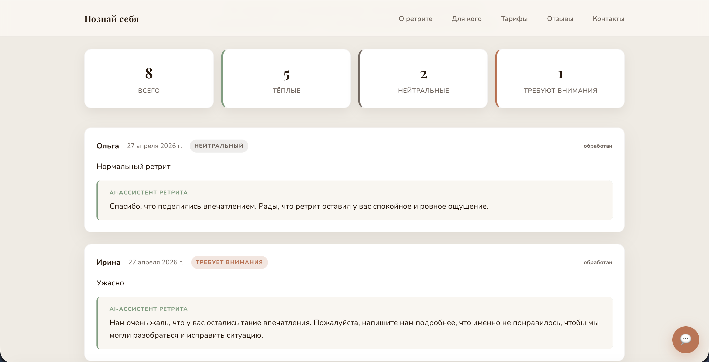
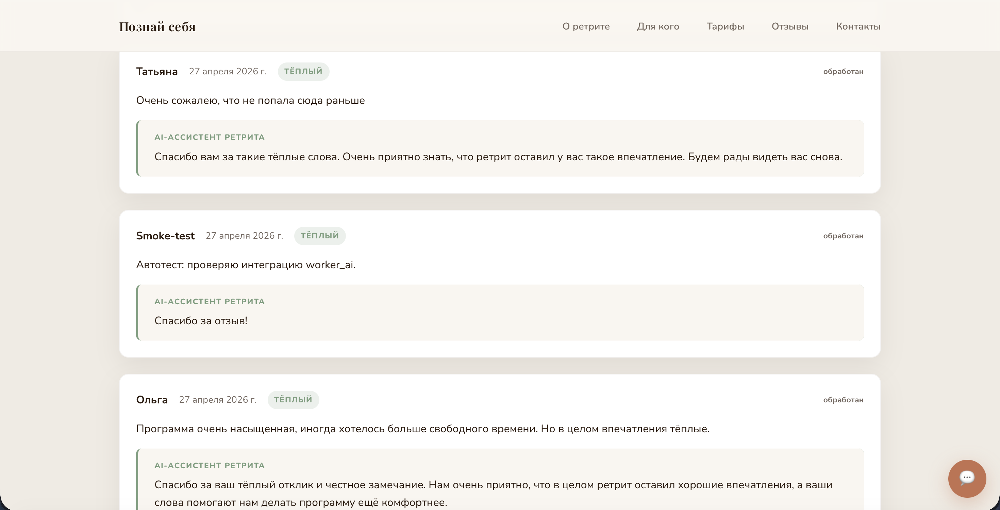
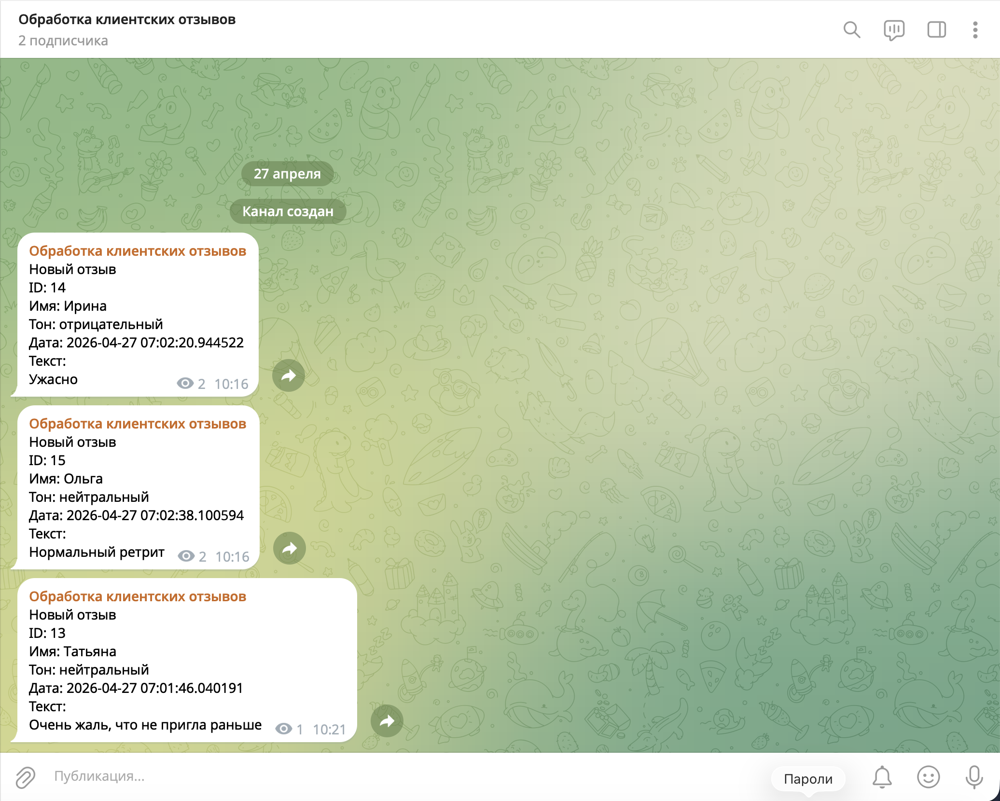

# AI review assistant for a website, with Telegram alerts

A service that replies to reviews left on a website by itself and sends the owner a Telegram alert about every new review. Live on the landing page [retreat.tatidzufri.com](https://retreat.tatidzufri.com/#reviews).

This is a practice project. The retreat, "Know Yourself" («Познай себя»), is a training scenario of a retreat center, not a real organization. Reviews and replies work in Russian and English. Case study: [tatidzufri.com/en/case/ai-reviews-manager](https://tatidzufri.com/en/case/ai-reviews-manager).



## About the project

The system has two parts. The website takes reviews through a form and shows them together with the replies. A background AI assistant checks every few seconds for anything new, detects the review's sentiment, writes a reply on behalf of the retreat team and posts it under the review. At the same time the owner gets a short summary in Telegram.

## The task

The retreat has a landing page, and people leave feedback right there. The goal was to collect reviews on the site without third-party widgets or sign-ups, see every new message in Telegram so no complaint slips by, and reply in a warm, human voice without sitting down to write each time.

Done by hand, a complaint can sit unanswered for days. Off-the-shelf services are either paid or reply with templates that don't match the project's tone.

## How it works

1. **A reviews section on the site.** A submission form, review cards and four statistics tiles: total, warm, neutral, needs attention. The assistant's reply shows right under the review.
2. **A background assistant.** The `worker_ai` service polls the site's API (every 10 seconds by default) and picks up reviews with the `new` status.
3. **Sentiment and reply in one request.** An OpenAI model detects the review's tone and writes the reply in the review's language. So "I hesitated for a long time, but went for it, my best investment in myself" is read as warm, even though it starts with doubt.
4. **A fallback.** If there's no OpenAI key or the request fails, tone is detected by marker words and the reply comes from prepared templates. The service keeps working.
5. **A Telegram alert.** The author's name, tone, date and review text go to the owner's private chat with the bot.
6. **Protection against fakes.** Only the assistant, holding the `X-Worker-Token`, can mark a review as processed and add a reply. Visitors can only leave reviews. The assistant ignores its own replies, so no auto-reply loops appear.

## What it looks like

**Replies matched to the tone.** To a warm review the assistant thanks sincerely, to a neutral one it answers briefly and calmly, to a complaint it apologizes gently and offers to sort it out. No bureaucratic phrasing and no template signatures.



**Telegram alerts.** Each new review reaches the owner with its number, author name, detected tone, date and text. If the assistant got the tone wrong, you can open the site and fix the reply by hand.



## Results

- A reply appears under a review a few seconds after it's submitted, with no one from the team involved.
- No review gets lost: even if the tone is detected wrong, the Telegram alert gives a chance to step in.
- Replies stay within three sentences, with no clichés and no signature. The style is set in the model's instruction.
- The statistics tiles show how many reviews fall into each sentiment.

## Tech stack

| Technology | What it's for |
|---|---|
| **Python** | Language of the site server and the AI assistant |
| **FastAPI + Uvicorn** | The site server: takes reviews from the form, serves the list to the page, updates statuses from the assistant |
| **SQLite + SQLAlchemy** | Reviews and replies in a single file. With SQLAlchemy the database can be switched to PostgreSQL without rewriting code |
| **OpenAI API** | Detects sentiment and writes the reply in one request. The model is set in `.env`, `gpt-4.1-mini` in the example |
| **httpx** | The assistant's requests to the site's API |
| **Telegram Bot API** | Alerts the owner about new reviews |
| **HTML, CSS, JavaScript** | A reviews section with no framework, so it drops into an existing landing page |
| **Docker** | A separate container for the assistant |

## Repository structure

- `site/`: the retreat landing page and its server, including the reviews section (`site/server/reviews.py`, `site/assets/js/reviews.js`).
- `worker_ai/`: the background AI assistant. Setup is described in `worker_ai/README.md`.
- `update_site.py`: a control script for local development, checks, building the embeddable reviews block and deploying to the server.
- `demo/`: screenshots from the site and Telegram.

## Running it

You need Python 3 (the containers use 3.12). Everything goes through `update_site.py`:

```bash
python update_site.py init          # environment, dependencies, database, demo reviews
python update_site.py serve         # site server on http://127.0.0.1:8000
python update_site.py static        # landing page on http://127.0.0.1:8080
python update_site.py worker        # the AI assistant
python update_site.py smoke-test    # checks the API the assistant uses
```

Before starting, fill in `site/server/.env` and `worker_ai/.env` from the `.env.example` files. `WORKER_API_TOKEN` must match in both, otherwise the site won't let the assistant update reviews. Without `OPENAI_API_KEY` the assistant runs on the fallback replies; without Telegram settings it just doesn't send alerts.

Other commands: `snippet` builds a standalone reviews block to embed in another site, `reset-review` returns reviews to the `new` status, `deploy` uploads `site/` to the server with rsync and ssh.

## Author

Tetiana Dziubas, AI automation engineer. I build Telegram bots, RAG assistants and LLM agents that take routine work off small teams. Case studies and contact: [tatidzufri.com/en](https://tatidzufri.com/en/).
